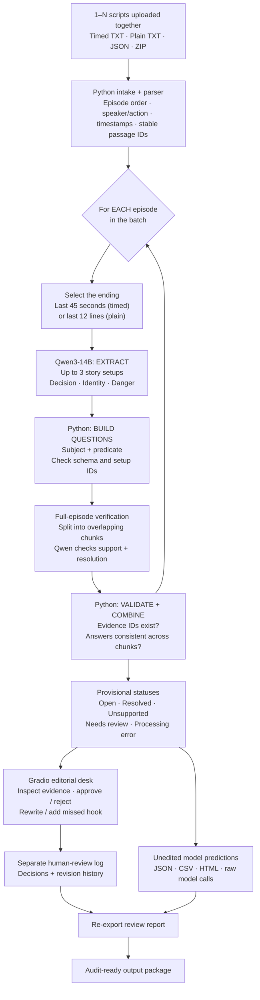
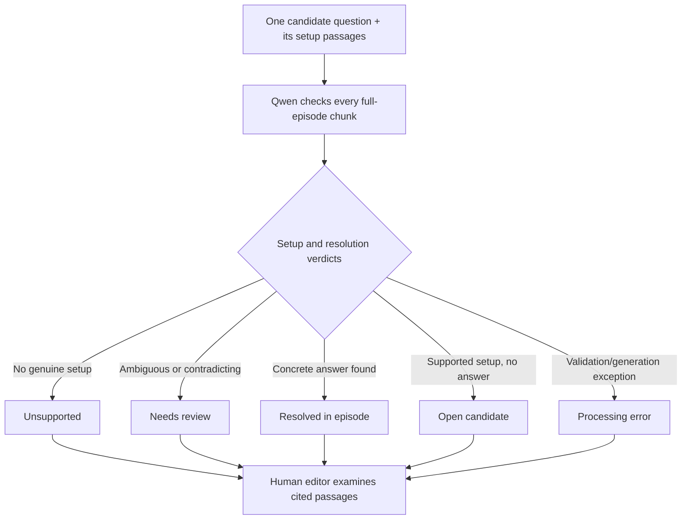
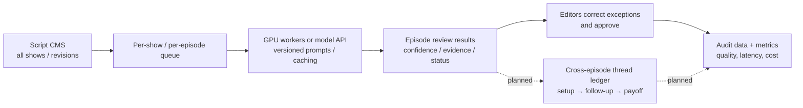

# Script Review — Architecture & video walkthrough

**Kuku AI Generalist Assignment · Problem 3 · Qwen3-14B + Python + Gradio**

> **What we built:** an AI-assisted editorial workstation that takes **multiple episode scripts in a single batch**, extracts checkable questions from each ending, verifies what that episode actually establishes, cites the original screenplay passages, and lets a human editor approve or correct the result. It does **not yet automatically search subsequent episodes for payoffs**. That is the proposed next-stage feature.

## 1. The problem we chose

Kuku's brief describes a growing share of AI-generated 1–2-minute microdramas. Frequent suspenseful endings are central to this format, but a production team needs to distinguish a **real unanswered story question** from (a) a question the episode already answered, (b) a weak or invented inference, and (c) a clue that the model mistakes for a resolution. A tool that simply declares every ending a cliffhanger would create more editorial work.

We chose **Problem 3** because it let us investigate an upstream story-quality bottleneck, not because Problems 1 or 2 are less valuable. The **hypothesis** is that repeated weak or confusing hooks could contribute to viewer fatigue. Industry reporting on repetitive microdrama plots motivates the investigation; we **have not established Kuku-specific dissatisfaction or causal retention effects**.

**Intended user:** a story editor. **Decision:** does this episode end with a concrete, supported question, and was it already answered? **Output:** a reviewable list with original evidence and human approval.

## 2. The complete architecture — show this diagram in your video

**Why two types of intelligence?** The LLM interprets narrative meaning. Ordinary Python handles input formats, ordering, stable evidence references, question construction, validating JSON, combining verdicts, preserving edits and exporting files. The LLM is not trusted to declare its own answer correct.

## 3. A short example of the flow

**Script ending:** "The commander offers Ren leadership of the rescue team. Ren looks at the paper but does not respond."

1. **Parser** creates passage references such as `E101_B0001` and keeps the original text.
2. **Extraction model** proposes `kind=decision, subject=Ren, predicate=accept command`, with a source reference.
3. **Deterministic code** forms the atomic question: **"Will Ren accept command of the rescue team?"**
4. **Verification model** checks the **complete episode**, not only the last scene. If no earlier or later passage in that episode answers the offer, the label is **open candidate**.
5. **Reviewer** reads the supporting passages before approving, rejecting or editing the question. A later spoken refusal in the **same episode** would instead make that concrete decision **resolved**.

**Important distinction:** extracting candidates from an ending is **not the same as** tracking a question through Episodes 2–10. The present code runs this process independently over many uploaded episodes; a cross-episode thread ledger is a roadmap item, not a demonstrated current capability.

## 4. What happens inside the Kaggle notebook

| Stage | Real implementation | Why it exists |
|---|---|---|
| **Input + parsing** | `inputs.py`, `timed_parser.py`; TXT / ZIP / JSON; sorted episode IDs | Allows batch runs and preserves reproducible passage references |
| **Ending selection** | `pipeline.py`; final **45 seconds** of timed scripts or final **12** plain-text lines | Focuses the candidate search on likely ending hooks |
| **LLM extraction** | `backend.py` + `pipeline.py`; **Qwen3-14B** extracts up to **three** typed setups per ending | Captures story semantics instead of keyword matching |
| **Question construction** | Python builds **Is …? / Will …?** from subject/predicate fields | Avoids unconstrained, multi-part or purely literary questions |
| **Verification** | Full episode split into roughly **9,000-character chunks** (maximum configured chunk budget); independent support and resolution judgments | An identity clue can justify asking a question **without answering it** |
| **Validation** | Check JSON shape, IDs, answer consistency and disagreement; constrained-format retry when needed | Rejects malformed/unsupported outputs without hiding uncertainty |
| **Editorial review** | `app.py` Gradio **Analyze** and **Editorial desk** tabs | Human can approve / reject / edit a candidate or add one missed by AI |
| **Exports** | `reports.py`: `results.json`, `review.csv`, `review.html`, `calls/*.json`, `human_reviews.json`, `review_history.jsonl` | Enables reproducibility and separates model claims from human decisions |

### Why Qwen3-14B on two T4 GPUs?

The prototype uses a downloadable **14-billion-parameter instruction model** with **4-bit NF4 weight quantization** to fit the Kaggle T4 ×2 environment without a paid inference API. The GPUs are distinct devices with model layers distributed between them. No training or fine-tuning was performed. **The same model** is called for candidate extraction and for checking the evidence: these are two prompted stages, not an independent-model ensemble. Extraction uses reasoning/thinking mode; verification requests shorter, constrained JSON.

### How verification becomes a status

This distinction is central: **"is there evidence for the question?"** and **"is the question answered?"** must be checked separately.

## 5. Gradio demo: exactly what to click

1. **Analyze:** choose a synthetic demo or upload multiple `episode_*.txt` scripts. Run analysis. It shows a dashboard, episode-by-episode predictions, status and source evidence. On the first request the model loads; later calls reuse it within the active GPU session.
2. **Editorial desk:** select a model-generated question. Read **Setup evidence** and **Verification evidence**, plus its answer/status. Choose **approved**, **rejected** or **needs_review**, optionally rewrite the question and add notes; click **Save editorial review**. Show **Add human-identified hook** to demonstrate handling an AI miss.
3. **Exports:** download HTML and ZIP. The original generated proposal remains intact; the editor's decision is saved in **`human_reviews.json`** and an append-only **`review_history.jsonl`**.
4. **Test lab:** available for development cases, but do not present its automated category check as a complete semantic-accuracy benchmark.

**Recording tip:** The actual six-case run took **14m 38s**, so capture the start of a real request and then cut transparently to the saved completed result; do **not** depict a multi-minute inference as instantaneous.

## 6. What the actual run proved — and did not

[Full audit](../outputs/20261108T081419_789562/AUDIT.md) · [Actual model predictions](../results/20261108T081419_789562/review.csv)

| Measured result | Value | Honest interpretation |
|---|---:|---|
| Synthetic scripts processed | **6/6** | Batch pipeline completed |
| Model candidate questions | **7** | Questions generated and verified |
| Unrecovered processing errors | **0** | One overlong extraction required a successful retry |
| Open-category agreement | **6/6** | Limited category check; **not 100% narrative accuracy** |
| Wall time | **877.77 s** | Expensive inference on small examples |
| Human-approved decisions in that run | **0** | Gradio review feature exists but was not used in this raw run |

**Correct examples:** Episode **201** identifies an unconfirmed ferryman identity as an **open** question. Episode **205** marks a danger as **resolved** when the threatened character safely escapes.

**Observed semantic failure — Episode 209:** The narrator tells the viewer that the guest is Queen Eira; a steward asks her name and she refuses. The model treats the steward's failed request as if his broader uncertainty about her identity was resolved. It was **not**. Even a structurally valid citation can accompany a wrong interpretation. This is why the reviewer can reject or rewrite suggestions.

Earlier development failures included overlong or invalid JSON, compound questions, over-rejection of legitimate hooks, wrong-character references, package conflicts and an export-path bug. We improved prompt constraints, evidence checks, isolated dependencies, format-repair retries and review persistence. **These changes improve reliability but do not prove real-world accuracy.**

## 7. How this could scale to Kuku's shows

A real deployment would process **versioned scripts** through a queue, cache unchanged analyses by script/model/prompt hash, retry or route failures to editors, and monitor processing time and cost. With more resources, add **character/alias tracking**, **multilingual evaluation**, and a persistent **series-level question ledger** to test whether hooks are revisited or paid off several episodes later. The last component is **not implemented** in this version.

**How to assess value:** editors independently annotate a set of unseen episodes, then compare human-only versus tool-assisted review on **missed hooks, false resolved calls, evidence accuracy, correction effort and minutes per episode**. Viewer retention and satisfaction would require a separate content experiment; they are not measured here.

---

**Project:** [GitHub prototype](https://github.com/seedhecode75/script-review) · [Run notebook](../Script_Review_Submission_Ready.ipynb) · [Three-minute recording guide](./VIDEO_SCRIPT.md). **Privacy:** use fictional/public examples in the public Gradio demo; never publish Kuku's confidential input pack.